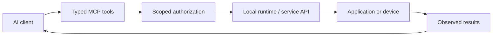

# Abhinav Musrif

**Applied AI Engineering · Agentic AI · LLM Applications · Model Context Protocol (MCP)**

2025 B.Tech Computer Science and Engineering graduate, VIT Chennai · Hyderabad, India

[Portfolio](https://abhinavmusrif.me/) · [LinkedIn](https://www.linkedin.com/in/abhinav-musrif-0a4738432/) · [Amretra Dynamics](https://github.com/Amretra-Dynamics)

## What I work on

I build the software layer that connects AI agents to real applications, tools, and devices. My independent engineering work focuses on typed tool interfaces, API integration, execution state, permission boundaries, failure recovery, and observable outcomes.

I am looking for entry-level **AI Engineer, Applied AI Engineer, Generative AI Engineer, LLM Engineer, and Agentic AI Engineer** opportunities, including paid AI engineering internships, across India or eligible remote locations.

## Selected engineering projects

| Project | What it demonstrates |
| --- | --- |
| [Megas Moves](https://github.com/Amretra-Dynamics/megasmoves) | Cross-platform agent tooling and MCP operator architecture: scoped permissions, local execution, browser/device interfaces, state and evidence. Active engineering preview. |
| [Megas Moves case study](https://github.com/abhinavmusrif/megas-moves-case-study) | Agent workflow coordination, worker sessions, command leasing, ordered events and verification. Architecture case study. |
| [Software Lifecycle Env](https://github.com/abhinavmusrif/software-lifecycle-env) | Deterministic AI-agent evaluation prototype for testing, debugging and maintenance, including hidden regression checks and a FastAPI interface. |
| [Overwatch](https://github.com/abhinavmusrif/overwatch) | Backend incident triage prototype with context inspection, risk scoring, deterministic fallback analysis and postmortems. |

Chitraagni is another independent product-engineering project: its current core is deterministic, with structured state, APIs, code generation and external AI interoperability through Megas MCP. It does not require an LLM to operate.

## Agent-system architecture

Conceptual view of the Megas Moves architecture. See the source and case study for implementation scope and limitations.

## Technical toolkit

- **Applied AI:** agent integrations, MCP, tool execution, workflow orchestration, agent evaluation prototypes.
- **Software foundations:** Python, FastAPI, TypeScript, REST APIs, JSON, SQL, PostgreSQL, Git, Linux, Docker.
- **Engineering practices:** typed schemas, authentication, scoped permissions, deterministic checks, observability and failure handling.
- **Currently deepening:** RAG, embeddings, vector search, prompt/context engineering, LLM evaluation and agent orchestration frameworks.

Additional systems work: [Industrial Edge Controller & Digital Twin](https://github.com/abhinavmusrif/industrial-edge-controller), a software-only C++17 simulation.

I distinguish prototypes and engineering previews from released production software, and prefer source-backed evidence over unverified metrics.

**Open to AI engineering opportunities.** [View my portfolio](https://abhinavmusrif.me/) or [connect on LinkedIn](https://www.linkedin.com/in/abhinav-musrif-0a4738432/).
