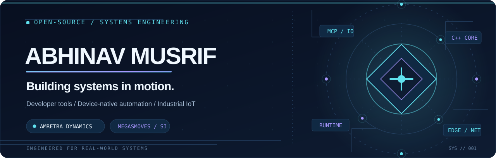
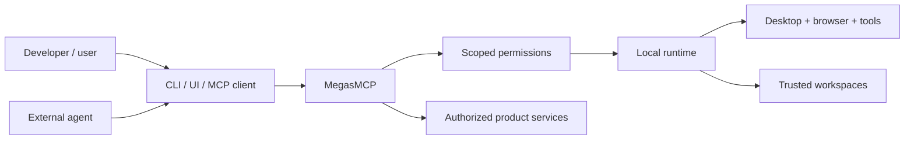

<picture>
  <source media="(prefers-color-scheme: dark)" srcset="./assets/hero-dark.svg">
  <source media="(prefers-color-scheme: light)" srcset="./assets/hero-light.svg">
  
</picture>

# Abhinav Musrif
**Systems software · Developer platforms · Device-native automation**

Founder of **[Amretra Dynamics](https://github.com/Amretra-Dynamics)** · Building **[MegasMoves](https://github.com/Amretra-Dynamics/megasmoves)**

[**Explore MegasMoves**](https://megasmoves.io/) · [**Engineering portfolio**](https://abhinavmusrif.me/) · [**Open-source organization**](https://github.com/Amretra-Dynamics) · [**Community**](https://t.me/megasmovesSI)

---

### Engineering beyond the application layer

I design and build software where **agents, operating systems, devices, networks and real-world workflows intersect**. My focus spans C/C++ systems engineering, Python and TypeScript services, local runtimes, developer tooling, secure automation, distributed systems and industrial IoT.

I care about the parts of a system that demos tend to skip: **reproducible behavior, explicit permissions, protocol boundaries, observability, failure recovery and code that can actually run**.

### Selected open-source engineering

| Project | Engineering focus |
| :-- | :-- |
| **[MegasMoves ↗](https://github.com/Amretra-Dynamics/megasmoves)** | **Multi-device SI agent and automation platform** with a local execution runtime, MegasMCP, a native desktop layer, Android, and an opt-in Chrome connector. Source-available engineering preview, not a finished production release. |
| **[Industrial Edge Controller & Digital Twin ↗](https://github.com/abhinavmusrif/industrial-edge-controller)** | **C++17 industrial gateway simulation** modeling MCU sensor acquisition, multithreaded control, Modbus TCP, MQTT, watchdogs, CRC framing, fault injection and SCADA monitoring. Software simulation, not a physical-hardware deployment. |
| **[Overwatch ↗](https://github.com/abhinavmusrif/overwatch)** | **Backend incident triage tooling** using a watchdog, crash parsing, contextual workspace inspection, risk scoring and postmortem generation. TypeScript/Node.js prototype with a deterministic offline analysis path. |
| **[Software Lifecycle Env ↗](https://github.com/abhinavmusrif/software-lifecycle-env)** | **Deterministic software-engineering agent benchmark** for testing, debugging and safe maintenance, with hidden regression checks, anti-shortcut validation and a FastAPI interface. Research prototype. |

<b>View how my work connects: from an agent request to trusted execution</b>

This is a conceptual view of the [MegasMoves architecture](https://github.com/Amretra-Dynamics/megasmoves), not a claim that every feature is production-ready.

### The technical terrain

**Languages & services:** C, C++, Python, TypeScript, JavaScript, SQL, FastAPI, Node.js, REST APIs.

**Systems & platforms:** Linux, Windows, native applications, process management, networking, distributed systems, Docker, CI/CD and observability.

**Protocols & automation:** Model Context Protocol (MCP), browser automation, MQTT, Modbus TCP, device communication, permissioned tool execution and industrial-control simulation.

**Engineering approach:** Local-first where it matters. Explicit trust boundaries. Deterministic testing. Reproducible builds. Evidence over inflated metrics.

### Currently building

- **MegasMoves:** a device-native **SI agent** platform with human-visible controls, typed MCP capabilities, browser and desktop operations, and multi-device direction.
- **Amretra Dynamics:** an engineering ecosystem for developer infrastructure, software creation and system-level products.
- **Systems experiments:** practical work across industrial communication, backend reliability and agent evaluation.

I publish work in stages and distinguish **architecture, prototype, preview and released software**. Follow the repositories for implementation details and current status.

### Connect / collaborate

I'm interested in **systems and backend engineering, C/C++, embedded and industrial software, developer infrastructure, secure automation and open-source collaboration**.

**[Personal website](https://abhinavmusrif.me/)** · **[GitHub projects](https://github.com/abhinavmusrif?tab=repositories)** · **[Amretra Dynamics](https://github.com/Amretra-Dynamics)** · **[MegasMoves community](https://t.me/megasmovesSI)**

Built deliberately. Documented openly. Tested against the real world.
