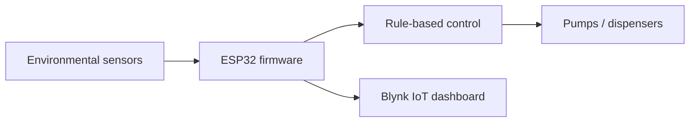

# IoT-Enabled Autonomous AgriBot

**Abhinav Musrif | B.Tech CSE capstone team project | VIT Chennai | Jan–Apr 2025**

A solar-powered agricultural robot prototype integrating environmental sensing, automated control and remote monitoring for resource-efficient farming.

## System flow

## Individual engineering contribution

- Programmed the ESP32 using Arduino IDE, interfaced analog and digital inputs, and implemented calibration for soil moisture, temperature, humidity and gas sensors.
- Designed threshold-driven irrigation and nutrient-dispensing logic and alerts for abnormal readings.
- Developed Wi-Fi sensor-data transmission and Blynk mobile dashboards for live readings, status and controls.
- Implemented sensor-failure and connectivity fallback routines; contributed to hardware/software integration and actuator-response testing.

## Outcome and scope

An academic prototype demonstrating embedded software, sensor integration, wireless telemetry and rule-based automation. Large-scale commercial deployment was outside the validated scope.

**Technologies:** ESP32, Arduino IDE, sensor calibration, Wi-Fi, Blynk IoT, rule-based control, prototype testing.

**Evidence:** Original VIT Chennai AgriBot capstone report, Section 1.6 (Project Contributions), PDF pp. 18–19; architecture and implementation, pp. 26–49.

*Public technical summary. Private university identifiers and team records are omitted.*
