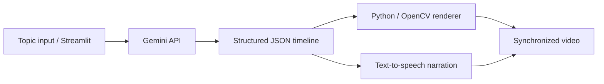

# AI-Driven Dynamic Video Creator for Education

**Abhinav Musrif | B.Tech CSE academic team project | VIT Chennai | 2024–2025**

An academic software prototype that converts an educational topic into a generated narrated video using structured generative AI outputs and deterministic media rendering.

## System flow

## Structured AI workflow

A Streamlit interface accepts the educational topic. Gemini generates a JSON representation with timing, text and visual elements. The timeline supplies explicit scene instructions to the renderer, separating AI content generation from deterministic execution.

## Deterministic rendering and narration

Python and OpenCV render text and shapes frame by frame. The workflow addresses text wrapping and placement, frame boundaries, transitions and synchronization of text-to-speech narration with the visual timeline.

## Outcome and scope

The team produced example educational videos and documented qualitative evaluation of text placement, visuals and narration alignment. This academic prototype demonstrates LLM API integration, structured outputs, Python rendering and multimodal workflow design. It is not a claim of commercial deployment or benchmarked performance.

**Technologies:** Python, Gemini API, JSON, OpenCV, Streamlit, text-to-speech.

**Evidence:** Original VIT Chennai project report, Chapters 3–4; PDF pp. 27–44 (architecture and implementation) and pp. 48–52 (generated outputs and qualitative evaluation).

*Public technical summary. Private university identifiers and team records are omitted.*
